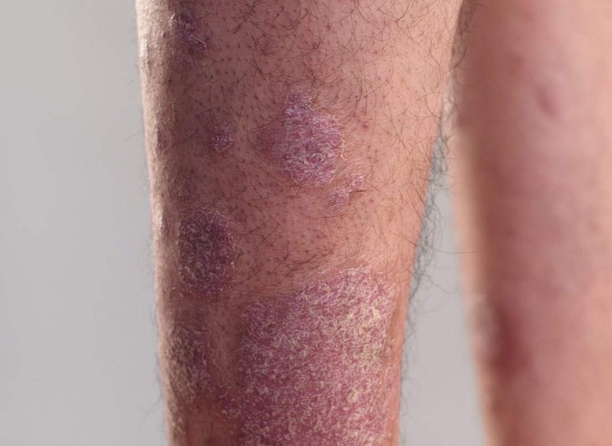

# AI Skin Specialist

[](https://ai-skin-specialist-wimu.onrender.com)
[](https://github.com/Manpreett03/AI-Skin-Specialist)

> 🌐 **Live Deployed Web App:** [https://ai-skin-specialist-wimu.onrender.com](https://ai-skin-specialist-wimu.onrender.com)
>
> ⚠️ **Disclaimer:** This is a student project. It gives general information only and is **not a medical diagnosis**. Always consult a licensed dermatologist for real medical concerns.



## Features

- Speak your concern with the microphone, or upload an audio file
- Upload a skin image, or a short video (a frame is extracted automatically)
- Speech-to-text, vision analysis and text-to-speech in one flow
- Live status messages while the app works ("Listening...", "The doctor is reviewing your case...")
- Clear error messages for problems such as a bad API key, no internet, or rate limits
- Responsive web interface built with Gradio

## How it works

```
 Voice recording ──► Speech-to-Text ──► transcript ─┐
                     (Groq Whisper)                 ├──► Vision model ──► Doctor's reply ──► Text-to-Speech ──► Audio
 Image / video ───► frame extraction (OpenCV) ──────┘    (Groq Qwen)         (text)            (Deepgram)
```

| Step | File | Service |
|------|------|---------|
| Transcribe the patient's voice | `voice_of_patient.py` | Groq, `whisper-large-v3` |
| Analyse image and write the reply | `brain_of_the_doctor.py` | Groq, Qwen vision model |
| Turn the reply into speech | `voice_of_the_doctor.py` | Deepgram Aura |
| Web interface and pipeline control | `main.py` | Gradio |

## Tech stack

Python 3.13, Gradio, Groq API, Deepgram API, OpenCV, Pillow, python-dotenv, uv

## Project structure

```
.
├── app.py                    # Cloud deployment entrypoint (Hugging Face Spaces)
├── main.py                   # Gradio UI and the main pipeline
├── brain_of_the_doctor.py    # Vision model: image + patient text -> doctor's reply
├── voice_of_patient.py       # Speech-to-text (Whisper Large-v3)
├── voice_of_the_doctor.py    # Text-to-speech (Deepgram Aura)
├── free_text_to_speech.py    # Standalone gTTS fallback script
├── requirements.txt          # Python dependencies for deployment
├── pyproject.toml            # Project dependencies and packaging
├── .env.example              # Template for API keys
└── docs/screenshot.png       # App screenshot
```

## Setup

**Requirements:** Python 3.13 and [uv](https://docs.astral.sh/uv/), plus free API keys from [Groq](https://console.groq.com/keys) and [Deepgram](https://console.deepgram.com).

1. Install dependencies:
   ```
   uv sync
   ```
2. Copy `.env.example` to `.env` and add your keys:
   ```
   GROQ_API_KEY=your_groq_key
   DEEPGRAM_API_KEY=your_deepgram_key
   GROQ_MODEL=qwen/qwen3.8-27b
   ```
3. Run the app:
   ```
   uv run main.py
   ```
4. Open http://127.0.0.1:7860 in your browser.

## Usage

1. Record or upload a short description of your skin concern.
2. Upload a skin image or video.
3. Click **Analyze Concern**.
4. Read the transcript and the doctor's guidance, and listen to the voice response.

## Configuration

All settings are optional except the two API keys.

| Variable | Purpose | Default |
|----------|---------|---------|
| `GROQ_API_KEY` | Groq authentication (required) | none |
| `DEEPGRAM_API_KEY` | Deepgram authentication (required) | none |
| `GROQ_MODEL` | Vision/chat model | `qwen/qwen3.6-27b` in the code; set it to `qwen/qwen3.8-27b` |
| `WHISPER_MODEL` | Speech-to-text model | `whisper-large-v3` |

## Troubleshooting

- **"rejected the API key":** the key in `.env` is wrong or expired. Create a new one, save `.env`, and restart the app (keys are only read at startup).
- **"model was not found":** the model name has been retired. Check Groq's model list and update `GROQ_MODEL`.
- **Microphone does nothing:** allow microphone access for the page in your browser, and open the app at `http://127.0.0.1:7860` or `localhost`.
- **"Could not reach ... service":** check your internet connection.

## Limitations

- Guidance is general and short by design, and the model can be wrong
- Only the first or a middle frame of a video is analysed, not the whole video
- Results depend on photo quality and lighting
- Requires internet access and working API keys

## Possible future work

- Support for more languages and voices
- A downloadable consultation summary
- Analysing several video frames instead of one
- Conversation history for follow-up questions

## Security note

API keys live in `.env`, which is listed in `.gitignore` and must never be committed or shared.
